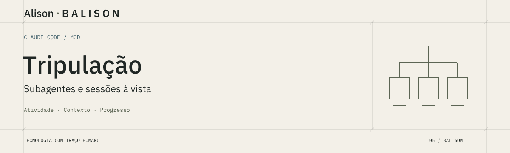

<h1 align="center">Tripulação</h1>

Subagentes, tarefas e sessões do Claude Code à vista.

  
  
  

  <a href="#começar-a-usar">Começar a usar</a> &nbsp; / &nbsp;
  <a href="#demonstração-e-recursos">Ver recursos</a> &nbsp; / &nbsp;
  <a href="#documentação-e-ajuda">Documentação</a>

---

## Sobre o projeto

A **Tripulação** é um mod do Claude Code que mostra a atividade dos subagentes em uma faixa acima do prompt. Em vez de acompanhar cada tarefa sem contexto, você vê o que cada agente está fazendo, as etapas que declarou e o contexto observado após as respostas. A faixa pode incluir outras sessões do Claude Code abertas com o mesmo diretório de configuração.

Ela foi feita para quem delega trabalho em paralelo e quer acompanhar o andamento pela própria interface. O mod também oferece controles para interromper um subagente ou outra sessão, sem parar a sessão atual.

## Demonstração e recursos

Os diagramas abaixo explicam a interface e usam dados de exemplo.

### Etapas e atividade

Cada linha combina pose do Clawd, tipo de agente, modelo, tarefa, tokens, tempo e atividade recente. A porcentagem vem da lista de tarefas mantida pelo subagente: item concluído conta como um, item em andamento como meio e item pendente como zero. A barra fica em até 99% até o agente responder. Sem lista de tarefas, a coluna mostra `—`, porque o mod não inventa um progresso.

### Contexto e controle

Para o mesmo modelo da sessão principal, a Tripulação usa a janela de contexto informada pelo Claude Code. Para modelos diferentes, a janela exibida é uma estimativa baseada nas regras do mod — 1 milhão de tokens por padrão e 200 mil para identificadores antigos reconhecidos; o marcador `[1m]` conta como 1 milhão. Não há consulta direta ao provedor para descobrir a capacidade real.

**Parar** interrompe o subagente selecionado. Nas sessões paralelas, o pedido é direcionado àquela sessão. Quando a faixa está recolhida, a contagem de agentes e tokens continua visível.

## Começar a usar

A instalação requer um Claude Code compatível com a API de mods usada pelo repositório. Abra o Claude Code no terminal (`claude`) e execute:

~~~text
/plugin install tripulacao --marketplace ba-lison/Claude-MOD-tripulacao
~~~

Responda `y` para adicionar o marketplace, aceite o escopo `user` e abra uma sessão nova. `/plugin install` funciona no terminal; depois de instalado, a faixa também aparece na aba Code do app desktop. Ela surge quando começa o primeiro subagente.

Para ver a barra avançar, peça aos subagentes que mantenham uma lista de tarefas. Sem essa lista, o progresso fica como `—`. As janelas de contexto de modelos diferentes da sessão principal são estimadas pelas regras descritas acima. Para atualizar o mod, rode `/plugin marketplace update tripulacao` e abra outra sessão nova.

## Documentação e ajuda

- [Protótipo da faixa de subagentes](https://github.com/ba-lison/Claude-MOD-tripulacao/blob/main/docs/prototipo/tripulacao-prototype.html)
- [Protótipo das sessões paralelas](https://github.com/ba-lison/Claude-MOD-tripulacao/blob/main/docs/prototipo/sessoes-prototype.html)
- [Registro de eventos, listas e controles](https://github.com/ba-lison/Claude-MOD-tripulacao/blob/main/hooks/register.tsx)
- [Leitura e estado das sessões](https://github.com/ba-lison/Claude-MOD-tripulacao/blob/main/hooks/sessoes.ts)

Para relatar um problema ou sugerir uma mudança, [abra uma issue](https://github.com/ba-lison/Claude-MOD-tripulacao/issues).

## Autoria e licença

Desenvolvido por [Alison Cruz](https://github.com/ba-lison) · **BALISON**.

Distribuído sob a [licença MIT](https://github.com/ba-lison/Claude-MOD-tripulacao/blob/main/LICENSE).

---

  <a href="https://github.com/ba-lison">
    <picture>
      <source media="(prefers-color-scheme: dark)" srcset="assets/readme/assinatura-grafite.svg">
      
    </picture>
  </a>
   
  Tecnologia com traço humano.

